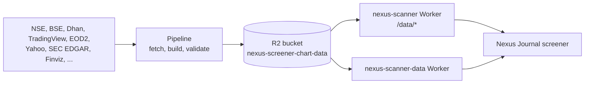

# Nexus Scanner

The data pipeline behind the Nexus screener, for Indian (NSE) and US equities. It fetches market data, computes
technicals, fundamentals, breadth, RS ratings and preset results, validates them, and publishes immutable releases
to Cloudflare R2. It also holds the two Workers that serve that data and the AI screen compiler.

There is no UI here. The screener UI is the `@anny26022/nexus-scanner` package in Nexus Journal
(`packages/nexus-scanner` in `new_nexys_ultimate`), which reads what this repository publishes.

> For research and data engineering, not investment advice. Upstream data can be delayed, incomplete, corrected,
> rate-limited or unavailable.

## Contents

- [Repository map](#repository-map) and [pipeline modules](#pipeline-modules)
- [Data flow](#data-flow): R2 layout, publication order, [published files](#published-files)
- [Automated runs](#automated-runs)
- [Data sources](#data-sources)
- [Screening model](#screening-model): conditions, built-in scans, formulas, match states
- [Local development](#local-development) and [deploying the Workers](#deploying-the-workers)
- [Recovery and troubleshooting](#recovery-and-troubleshooting) and [limits](#limits)

## Repository map

| Location | What it is |
| --- | --- |
| [`DO NOT DELETE EDL PIPELINE/`](DO%20NOT%20DELETE%20EDL%20PIPELINE/) | The Python pipeline (`edl-pipeline` package in `src/edl_pipeline/`) and its fetch/build scripts. India runs from `run_full_pipeline.py`, the US from `PYTHONPATH=src:. python -m edl_pipeline.markets.us <root>`. The directory name is kept because workflows depend on it. |
| [`frontend/`](frontend/) | Despite the name, no UI: the Python publishers (`publish_snapshot.py`, `publish_us.py`, `publish_etfs.py`, `site_data.py`, `chart_publication.py`, the Earnings Pulse and concall steps) and the shared filter catalogue (`src/`) the AI Worker compiles against. See [`frontend/README.md`](frontend/README.md). |
| [`workers/screener-ai/`](workers/screener-ai/) | The `nexus-scanner` Worker ([`wrangler.jsonc`](wrangler.jsonc)): serves `/data/*` from R2, answers `POST /api/screener/ai-compile`, and redirects every other page to the journal's `/scanner`. |
| [`workers/r2-delivery/`](workers/r2-delivery/) | The `nexus-scanner-data` Worker: read-only GET/HEAD for the public R2 prefixes `objects/`, `releases/`, `daily/`, `monthly/` and `snapshots/`. |
| [`tools/`](tools/) | R2 state sync (`pipeline_state.py`, `us_state.py`), historical snapshot backfills, the Tijori export, the Actions cache pruner, offline benchmarks, and their tests. |
| [`reference/`](reference/) | Inputs the next run reads and whose history Git keeps: index constituents (daily), Tijori overviews and Dhan groups (weekly). |
| [`docs/`](docs/) | Design notes, e.g. [site data in R2](docs/site-data-r2.md), [pipeline state in R2](docs/pipeline-state-r2.md), [ETF snapshots](docs/etf-snapshots.md), [rotation](docs/rotation.md). |
| [`.github/workflows/`](.github/workflows/) | Refresh, backfill, CI and cache-retention workflows (below). |

### Pipeline modules

Under `DO NOT DELETE EDL PIPELINE/src/edl_pipeline/`:

| Module | What it does |
| --- | --- |
| `runner` | Orchestrates the stages and script lanes, compression, validation, cleanup and reports. |
| `publication` | Builds in an isolated stage and promotes only a complete, validated output set, then runs `frontend/publish_snapshot.py`. |
| `validators`, `quality` | Schema, required-field, count and readability checks; whole-publication integrity and coverage checks. |
| `scanner.trend` | The condition registry and expression-tree evaluator over OHLCV, with match / no-match / unavailable results. |
| `scanner.patterns` | New highs/lows, 52-week distance, ATR, consolidation, range contraction, inside bars, unfilled gaps, VCP legs, horizontal resistance. |
| `scanner.context` | Relative strength and RS ratings, fundamentals, earnings, classification, liquidity, price bands, surveillance, index membership, breadth. |
| `scanner.indicators`, `scanner.financials`, `scanner.query` | Indicator series (SMA, EMA, RSI, MACD, Supertrend, …), quarterly growth and P/E, the text-query compiler. |
| `scanner.presets` | The versioned 45-scan preset library and its validation against the registry. |
| `breadth`, `transforms` | Eligible universes, benchmark alignment, breadth and MBI; fundamental, event and breadth artifacts. |
| `sources` | NSE archive, Dhan and news retrieval. |
| `markets.us` | The US market: NYSE calendar, Dhan, Yahoo, TradingView, SEC EDGAR, Finviz, and the US build. |

## Data flow



### What goes where in R2

| Prefix | Contents | Served |
| --- | --- | --- |
| `releases/<rev>/` | Immutable release files (packed stocks, IPOs, ETFs, financial history, market overview, chart directory, data index, `release.json`). India and US releases share this prefix. | Both Workers |
| `site/data/` | Pointers: `current.json`, `sessions.json`, `price-band-history.json`, `ai-filter-choices.json`, and the Earnings Pulse, heatmap, company and concall indexes. US pointers are under `site/data/us/`. | `nexus-scanner` at `/data/...` |
| `objects/<hash>.json.gz` | Content-addressed data objects (per-symbol chart payloads and others the data index names). | `nexus-scanner-data` |
| `monthly/<month>/` | The last chart set and release of each month; not covered by the lifecycle rule. | `nexus-scanner-data` |
| `snapshots/`, `snapshots/us/` | One archived snapshot per session, for the date picker. | `nexus-scanner-data` |
| `daily/` | Legacy chart layout and daily rotation history; a lifecycle rule expires it after 90 days. | `nexus-scanner-data` |
| `pipeline-state/` (US under `pipeline-state/us/`) | Files carried from one run to the next; the version before the latest run is under `previous/` for rollback. | Not served |

A release goes live in a fixed order: the revision files are uploaded with `rclone copy --immutable --checksum` and
read back, then the AI filter catalogue, the price-band ledger and `sessions.json`, and `current.json` last. A run
that fails part-way leaves the previous release live, and the publisher refuses to publish an older session over
the current one. Details: [docs/site-data-r2.md](docs/site-data-r2.md).

Live releases and pipeline state are in R2. India refreshes commit only `reference/`, and the weekly US sync
commits the Finviz universe files. The checkout still tracks frozen copies from before the move to R2: the
published data in `frontend/public/data/` (local publications overwrite it) and the pipeline-state files in the
pipeline directory (used when nothing has been pulled from R2).

### Published files

Each release under `releases/<rev>/` (named by a content hash, so a same-session correction gets a new revision
instead of overwriting the old one) holds:

| File | Contents |
| --- | --- |
| `release.json`, `index.json` | Release metadata (session, revision, URL templates) and the chart/data index naming its objects (`data-index.json` in a local publication). |
| `stocks.packed.json.gz`, `stocks.json.gz` | The stock snapshot: browser-safe metrics and precomputed preset results; packed and plain. |
| `ipos.json.gz`, `etfs.json.gz` | IPO catalogue; ETF snapshot (advertised only when its quotes match the stock session, see [ETF snapshots](docs/etf-snapshots.md)). |
| `financial-history.json.gz`, `financial-history/` | Quarterly financial history, also per symbol. |
| `market-overview.json.gz`, `benchmark.json.gz`, `theme-classification.json.gz`, `universe-classification.json` | Market page, benchmark series and classifications. |
| `earnings-calendar.json.gz`, `price-band-history.json.gz` | Earnings dates; NSE price-band ledger. |
| `chart-directory.json.gz` | The per-symbol chart object names. |

**Chart payloads** (`build_chart_artifacts.py`, schema 3) are content-addressed objects, one per symbol:

| Field | Content |
| --- | --- |
| `symbol`, `historyStartDate` | Identity and first available candle. |
| `candleChunks` | Two object hashes: candles before the session's year and candles in it, so an unchanged past stays cached. Each candle has date, OHLC and volume through the published session; candles are not truncated, so depth equals what the history cache holds. |
| `volumeEvents` | Highest and lowest volume across available history; highest-volume day of each of the last 60 months, 20 quarters and 10 years; lowest-volume day of each of the last 20 quarters. |
| `corporateActions` | Actions with an ex-date on or before the session, with a classification. |
| `earnings` | Earnings filed on or before the session. |
| `marketNews` | The latest 50 items; can be empty when the optional news source failed. |

Regulatory announcements are a separate content-addressed catalogue (`announcement_artifacts.py`) that the chart
index references by hash.

**Pipeline artifacts** in the pipeline directory, carried between runs through R2 state:
`all_stocks_fundamental_analysis.json.gz` (the canonical stock snapshot), `sector_analytics.json.gz`,
`market_breadth.json.gz`, `market_breadth_v2.json.gz`, `sector_breadth_v2.json.gz`,
`breadth_universe_snapshot.json.gz`, `all_indices_history_v2.json.gz`, `all_indices_list.json`,
`corporate_action_ledger.json.gz`, `nse_corporate_actions.json.gz`, `nse_fno_ban.json.gz`,
`rs_rating_daily.json.gz`, `ipo_screener.json.gz`, `shareholding_history.json.gz`,
`quarterly_financial_history.json.gz` and `earnings_calendar.json.gz`, plus the IPO archives. Each run also writes
`data_quality.json`, `mainboard_universe_report.json`, `nse_universe_reconciliation.json` and `pipeline_report.json`,
or `pipeline_failure_report.json` / `data_quality_failure.json` when it stops; the workflows upload the reports as
diagnostics.

## Automated runs

The scheduled refreshes have no GitHub `schedule:` trigger. The `nexus-gh-cron` Worker
(`workers/gh-cron/schedule.ts` in `new_nexys_ultimate`) starts them through `workflow_dispatch`, because GitHub's
own schedule ran hours late. Times are India time.

| Workflow | Started | What it does |
| --- | --- | --- |
| [`daily_refresh.yml`](.github/workflows/daily_refresh.yml) | 17:30 on NSE trading days | Updates the EOD2 checkout, runs the pipeline and publisher tests, pulls state and pointers from R2, runs the pipeline (`--phase fetch`, then `--phase build` with charts to R2), refreshes India's Earnings Pulse history and the heatmap and concall summaries, publishes changed indexes, pushes state, and commits `reference/`. |
| [`weekly_eod2_refresh.yml`](.github/workflows/weekly_eod2_refresh.yml) | Sunday 09:00 | The same build with the EOD2 adjusted-history overlay, plus the Tijori overview export, the Dhan group sync and a full concall walk (`--full`). |
| [`us_daily_refresh.yml`](.github/workflows/us_daily_refresh.yml) | Tuesday to Saturday 07:00 | Refreshes the US Earnings Pulse calendar, builds the US root (exits 75 and skips publication if New York's session has not closed), pushes US state, fetches the US ETF snapshot and publishes the US release (`frontend/publish_us.py`, pointer `/data/us/current.json`). |
| [`us_weekly_sync.yml`](.github/workflows/us_weekly_sync.yml) | Saturday 11:30 | Crawls the Finviz thematic and ownership universes and commits the three `us_*.json` files in the pipeline directory. |
| [`cache-retention.yml`](.github/workflows/cache-retention.yml) | After each daily or weekly refresh, and daily at 01:15 UTC | Prunes obsolete Actions cache snapshots (`tools/prune_actions_caches.py`). Manual runs default to a dry run. |
| [`concall_refresh.yml`](.github/workflows/concall_refresh.yml) | Manual | Refreshes only the concall summaries (`frontend/concall_history.py`, `--full` by default) and publishes their two pointers, without the rest of the daily refresh. |
| [`etf_snapshot_only.yml`](.github/workflows/etf_snapshot_only.yml), [`us_etf_snapshot_only.yml`](.github/workflows/us_etf_snapshot_only.yml) | Manual | Publish only the ETF snapshot into the live release, for a day the ETF source failed. |
| [`backfill_historical_snapshots.yml`](.github/workflows/backfill_historical_snapshots.yml), [`us_backfill_historical_snapshots.yml`](.github/workflows/us_backfill_historical_snapshots.yml) | Manual, with a date range | Generate archived session snapshots for past dates, upload them and extend `sessions.json`. |
| [`ci.yml`](.github/workflows/ci.yml) | Pull requests, pushes to `main` | Pipeline unit tests, the critical-path byte-equivalence check (PRs only), the wheel check, `tools/` and workflow-contract tests, `compileall`. |
| [`frontend-ci.yml`](.github/workflows/frontend-ci.yml) | Pull requests and pushes that touch `frontend/`, `workers/` or the Worker config | Catalogue and Worker tests (Vitest), the data Worker test, type checks, the `frontend/` Python tests with a real `rclone`, `npm audit`. |

The India refresh, backfill, concall-only and ETF-only workflows and the cache pruner share the `daily-data-refresh`
concurrency group, so they never run at once; the US daily, backfill and ETF-only workflows share `us-daily-refresh`.
Each sets `queue: max`, so a waiting run is never cancelled by a newer one (the gh-cron Worker does not retry a
cancelled run). Price, enrichment and history caches live in GitHub Actions caches
(`.github/actions/restore-refresh-history`). They speed runs up and can be evicted.

The workflows read `R2_ACCOUNT_ID`, `R2_ACCESS_KEY_ID` and `R2_SECRET_ACCESS_KEY` as secrets and
`R2_PUBLIC_BASE_URL` as a repository variable. The US refresh also reads the `SEC_CONTACT` secret, the contact SEC
asks automated clients to send; without it, EDGAR filings are skipped.

## Data sources

India: NSE and its archives (OHLCV, delivery, F&O, bans, surveillance, corporate actions, announcements, index
constituents), BSE filings, Dhan (screener fields, statements, history, IPOs, news, groups), TradingView's scanner
(ETFs and extra indicators), the [EOD2](https://github.com/BennyThadikaran/eod2_data) adjusted-history repository,
Tijori, Earnings Pulse and concall summaries.

US: Dhan (universe, snapshot, daily history, statements), Yahoo Finance (deep history), TradingView (fields Dhan
lacks), SEC EDGAR (filings and results dates) and Finviz (themes and ownership). See
[`docs/US_MARKET.md`](DO%20NOT%20DELETE%20EDL%20PIPELINE/docs/US_MARKET.md).

A failed required stage stops publication. Optional steps (Earnings Pulse, concalls, Tijori, ETFs) warn and leave
their last published data in place.

## Local development

Prerequisites: Python 3.10 for the pipeline (the refresh workflows and `ci.yml` use it; the package declares 3.9+;
`frontend-ci.yml` runs the `frontend/` Python tests on 3.12), Node 24 (`.nvmrc`), and `rclone` only to reach R2.

```bash
cd "DO NOT DELETE EDL PIPELINE"
python3 -m venv .venv && source .venv/bin/activate
pip install -r requirements.txt
python3 -m unittest discover -s tests -v
```

Run the India pipeline. It fetches live data and writes into the pipeline directory:

```bash
python3 run_full_pipeline.py                                  # all phases
python3 run_full_pipeline.py --phase fetch --stage /tmp/edl-stage
python3 run_full_pipeline.py --phase build --stage /tmp/edl-stage
```

Build a US root, also from the pipeline directory (`--limit N` keeps only the N largest stocks for a quick check):

```bash
PYTHONPATH=src:. python3 -m edl_pipeline.markets.us /tmp/us-root --limit 50
```

With `EDL_CHART_STORAGE=local` (the default), publication writes to `frontend/public/data` and uploads nothing. To
start from the live state instead of the frozen Git copies, pull it with the R2 settings set. This and every command
below runs from the repository root:

```bash
cd ..
python3 tools/pipeline_state.py pull
python3 frontend/site_data.py pull
```

Run the AI Worker locally. It listens on port 8787 and reads `frontend/public/data`. Copy `.dev.vars.example` to
`.dev.vars` to use Groq; without a key it uses Workers AI.

```bash
npm install                      # also installs frontend/
python3 frontend/site_data.py ai-choices
npm run dev:ai
```

Tests outside the pipeline directory:

```bash
python3 -m unittest discover -s frontend -p 'test_*.py' -v
(cd frontend && npm test && npm run typecheck)
node --test workers/r2-delivery/test.mjs
npm run check:worker
```

### Settings

| Variable | Purpose |
| --- | --- |
| `EDL_CHART_STORAGE` | `local` (default) or `r2`; any other value is rejected. |
| `R2_ACCOUNT_ID`, `R2_ACCESS_KEY_ID`, `R2_SECRET_ACCESS_KEY`, `R2_PUBLIC_BASE_URL`, `R2_BUCKET` | R2 publication and state sync. Server-side only. |
| `EDL_EOD2_DATA_DIR` | An EOD2 data checkout for the adjusted-history overlay; the overlay is skipped when unset. |
| `EDL_FETCH_OHLCV`, `EDL_FETCH_OPTIONAL`, `EDL_CLEANUP_INTERMEDIATE` | Pipeline switches, see `src/edl_pipeline/config.py`. |
| `EDL_US_BASE_DIR` | The US root that `publish_us.py` publishes. |
| `SEC_CONTACT` | Contact sent with SEC EDGAR requests. |
| `GROQ_API_KEY` | Optional Worker secret for the AI compiler. |

## Deploying the Workers

`nexus-scanner` is Git-connected (Workers Builds) and deploys from `main`. `nexus-scanner-data` is deployed by hand
with `npm run deploy:data`; `npm run deploy` deploys both. Both configs pin their Cloudflare account, so a Wrangler
logged into another account is refused. Data refreshes need no deploy.

## Screening model

Conditions are a typed contract shared by three places: the Python registry (`CONDITION_REGISTRY` in
`scanner/trend.py`, which merges `scanner/patterns.py` and `scanner/context.py`), the TypeScript catalogue in
`frontend/src/data/` that the AI compiler uses, and Nexus Journal's copy of that catalogue. Change them together.
The browser evaluates precomputed snapshot metrics; the Python registry accepts wider parameter choices.

### Conditions

| Family | Conditions (registry id) |
| --- | --- |
| Trend and moving averages | `indicator_compare` (comparison or crossover between indicators or a value, with offsets), `ma_convergence`, `divergence` (confirmed regular/hidden, no future-bar leakage), `supertrend`, `adx`, `persistent_momentum`, `price_vs_ema`, `price_vs_sma`, `ema_shakeout_reclaim`, `ma_stack`, `ma_slope`, `percent_days_above_ma`, `consecutive_up_days` |
| Price, range and patterns | `price_change_percent`, `gap_up`, `gap_down`, `new_high`, `new_low`, `percent_from_52w_high`, `percent_from_52w_low`, `percent_from_ath` (split- and bonus-adjusted, from EOD2 history), `atr_percent`, `adr_percent`, `consolidation_range`, `range_contraction`, `vcp_contraction_legs`, `inside_bar` (daily or weekly), `unfilled_gap`, `horizontal_resistance_line` |
| Volume, liquidity and delivery | `relative_volume`, `volume_trend`, `highest_volume`, `absolute_volume`, `average_turnover`, `delivery_percent`, `delivery_percent_spike` |
| Trading controls | `market_cap`, `free_float_market_cap`, `price_range`, `price_band`, `circuit_band_minimum`, `series`, `fno_ban`, `exclude_surveillance` (ASM and GSM; both lists must be available) |
| Relative strength and universe | `relative_strength`, `rs_new_high`, `rs_rating`, `index_membership`, `market_breadth`, `sector`, `industry`, `listing_age_days` |
| Fundamentals and earnings | `pe_ratio`, `earnings_growth` (QoQ or YoY for revenue, net profit, PBT, EPS or OPM, subject to filing age), `fundamental_metric`, `absolute_eps`, `dividend_yield`, `eps_last_year_higher`, `days_since_earnings` |

Indicators for `indicator_compare` include SMA, EMA, WMA, RSI, MACD, Stochastic, CCI, MFI, Williams %R, ROC, OBV,
Bollinger and Donchian bands (`scanner/indicators.py`).

### Built-in scans

The preset library (`frontend/src/data/presetDefinitions.json`, validated by `scanner/presets.py`) has exactly 45
scans: Persistent Momentum, Easy Money, Relative Strength Leaders, RS Line at New High, Stage 2 Uptrend, Momentum
Burst, Quiet Strength, 52-Week High Breakout, 20-Day High on Record Volume, Breakout from Tight Base, Pocket Pivot,
ADX Trend Breakout, Circuit-Safe Breakout, VCP Contraction, Inside Bar Coil, Weekly Inside Bar, Volume Dry-Up Base,
Flat Base, Horizontal Resistance, Flags & Pennants, Low-ATR Coil, 21 EMA Pullback, 50 EMA Shakeout, Higher-Low
Pullback, Gap Support Retest, Volume Surge, Highest Volume in 3 Months, Delivery-Backed Accumulation, Sustained
Accumulation, Unfilled Gap Up, Gap & Go, Gap Down Washout, 52-Week Low Bounce, RS Divergence Turn, Relative Weakness,
Earnings Growth Momentum, Post-Earnings Drift, Growth at a Fair Price, Revenue & Profit Acceleration, Pre-Earnings
Coil, Breadth-Gated Leaders, Liquid Trading Universe, Fresh IPO Base, Nifty 500 Momentum and Midcap Breakout.

India presets share eligibility floors (`presetEligibility.json`): market cap at least ₹1,000 Cr, close at least
₹10 and 50-session average turnover at least ₹5 Cr. There is no upper market-cap or price limit and no blanket
circuit exclusion. The US release uses its own floors.

### Calculation conventions

Windows count trading sessions and stop at the published session. Missing required history gives `unavailable`;
a shorter window is not substituted.

| Calculation | Rule |
| --- | --- |
| SMA(N) | Mean of the latest N closes; needs all N. |
| EMA(N) | Exponential average, `span=N`, `adjust=False`, with N sessions of warm-up. |
| Return(N) | `100 × (close / close N sessions earlier − 1)`; needs N+1 closes. |
| Gap % | `100 × (open / prior close − 1)`. |
| RVOL(N) | Volume divided by the mean of the preceding N volumes (today excluded). |
| Average turnover(N) | Mean of `close × volume` over N sessions, in ₹ Cr (÷ 10,000,000). |
| ADR(N) % | Mean of `100 × (high − low) / close`. |
| ATR % | Wilder-smoothed true range (`max(high − low, abs(high − prior close), abs(low − prior close))`) ÷ close × 100. |
| Consolidation range % | `100 × (highest high − lowest low) / final close` over the base. |
| Relative strength(N) | Stock return minus benchmark return over the same sessions, in percentage points. |
| RS rating | 1–99 percentile across the Nifty 500 for a 21, 63, 126 or 252-session horizon, or the 40/20/20/20 front-weighted composite of the four. |
| Quarterly growth % | `100 × (latest − base) / abs(base)`; QoQ uses the prior quarter, YoY the same quarter a year earlier. A zero or missing base is unavailable. |
| Historical P/E | Market cap ÷ net profit of four consecutive announced quarters; missing quarters or non-positive profit are unavailable. |

**Persistence.** `persistent_momentum` passes when any requested EMA has stayed below the close for its run; the
Persistent Momentum scan uses 10 EMA for 20 sessions, 20 EMA for 30 or 50 EMA for 50, AND 20-session turnover of at
least ₹5 Cr. It defaults to `reclaim_by_extreme`: one contrary close does not reset the run when a later bar trades
through that bar's extreme and closes back on the right side. `price_vs_ema` defaults to `extreme_reset`: a contrary
close arms its low (above-runs) or high (below-runs), and only a later trade through that level resets the run.
`price_vs_sma` defaults to `strict_close`, where every close must be on the right side.

**Inside bars.** A bar is inside when its high is at or below, and its low at or above, the preceding bar's; N
consecutive inside bars need N+1 bars. Weekly bars are built from daily sessions by ISO week. The default
`completed` mode leaves out the current week; `current` includes it and marks the result provisional.

**Signal timing.** `fired_within=1` means the latest session; 2 also allows the one before.

### Match states

Each condition returns `match`, `no_match` or `unavailable`. Unavailable means a required input was missing, too
short, stale or not aligned to the screen's session (OHLCV gaps, moving-average warm-up, delivery gaps, absent index
membership, stale financials, intraday history that is not collected). It never becomes a match. Groups combine
them like this (`_combine_group` in `scanner/trend.py`):

| Group | Result |
| --- | --- |
| AND | `no_match` if any child is `no_match`; otherwise `unavailable` if any is; otherwise `match`. |
| OR | `match` if any child is `match`; otherwise `unavailable` if any is; otherwise `no_match`. |

### Adding a condition or preset

1. Add the condition to the Python registry and implement it, with explicit missing-data and session-alignment
   behaviour.
2. Add its typed inputs to the catalogue in `frontend/src/data/` and to Nexus Journal's copy.
3. Test match, no-match and unavailable outcomes.
4. For a built-in scan, add its declarative definition to `presetDefinitions.json`; `scanner/presets.py` checks the
   library against the registry.

## Recovery and troubleshooting

**A refresh fails before publication.** Look at the failed step and the uploaded diagnostics
(`pipeline_failure_report.json`, `data_quality_failure.json`, `price_validation_report.json`). Fix the source,
schema, freshness or quality problem and rerun the workflow. Do not bypass validation to advance the session date.
The previous release stays live until a run succeeds. Promotion copies files back from a backup on ordinary
exceptions, including publisher errors; it is not a transaction across a process crash, and history caches may
already have been updated.

**A diagnostic run.** `EDL_FETCH_OHLCV=0 python3 run_full_pipeline.py`, from the pipeline directory, skips the OHLCV refresh and never changes
published files.

**Undo one bad run's state.** `pipeline-state/previous/<file>` (US: `pipeline-state/us/previous/`) holds the version
before the latest push; copy it back over the current object. See [docs/pipeline-state-r2.md](docs/pipeline-state-r2.md).

**Roll back a release.** Point `site/data/current.json` back at a known good revision only if every object that
revision names still exists. Reverting a Git commit does not change what is live, and does not recreate expired
`daily/` objects or evicted Actions caches.

**History is missing or shorter than expected.** Check the symbol's earliest and latest cached dates and its chart
`historyStartDate`. A restored cache or a weekly run does not prove inception coverage. To fill a bounded range
from another compatible EDL directory (or, without `--source-root`, by fetching the missing days), run from the
pipeline directory:

```bash
python3 sync_local_scanner_history.py --source-root /path/to/EDL --from-date 2026-09-29 --as-of-date 2026-10-01
```

Then rebuild charts and the release from matching artifacts (`python3 build_chart_artifacts.py`, then
`python3 frontend/publish_snapshot.py` from the repository root). The full pipeline normally does this in order;
never publish a pointer from mismatched financial, OHLCV, delivery and chart sessions.

**Ask AI answers 409.** The browser's dataset revision differs from `ai-filter-choices.json`. The publisher uploads
the catalogue just before `current.json`; check that the last publication finished.

## Limits

- Historical technical screens need local OHLCV history aligned to the requested session.
- Intraday turnover modes stay unavailable until intraday history is collected.
- Current-only fields (classification, P/E, index membership) cannot be reconstructed for past sessions from a
  later snapshot.
- Upstream sources change format or refuse requests; passing tests do not prove a live source returned complete data.
- The US release has no F&O, delivery or price-band data (Indian sources), and amounts are in millions of dollars.
- Results match this pipeline's data and universe; another provider can differ.

## Further reading

- [Pipeline guide](DO%20NOT%20DELETE%20EDL%20PIPELINE/README.md),
  [market breadth](DO%20NOT%20DELETE%20EDL%20PIPELINE/docs/MARKET_BREADTH.md),
  [release checklist](DO%20NOT%20DELETE%20EDL%20PIPELINE/docs/RELEASE_CHECKLIST.md),
  [US market](DO%20NOT%20DELETE%20EDL%20PIPELINE/docs/US_MARKET.md)
- [AI compiler](workers/screener-ai/README.md)
- [Index universe reference](INDEX_UNIVERSE_REFERENCE.md)
- [Contributing](CONTRIBUTING.md)

## License

[MIT](LICENSE)
