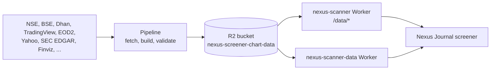

# Nexus Scanner

The data pipeline behind the Nexus screener, for Indian (NSE) and US equities. It fetches market data, computes
technicals, fundamentals, breadth, RS ratings and preset results, validates them, and publishes immutable releases
to Cloudflare R2. It also holds the two Workers that serve that data and the AI screen compiler.

There is no UI here. The screener UI is the `@anny26022/nexus-scanner` package in Nexus Journal
(`packages/nexus-scanner` in `new_nexys_ultimate`), which reads what this repository publishes.

> For research and data engineering, not investment advice. Upstream data can be delayed, incomplete, corrected,
> rate-limited or unavailable.

## Repository map

| Location | What it is |
| --- | --- |
| [`DO NOT DELETE EDL PIPELINE/`](DO%20NOT%20DELETE%20EDL%20PIPELINE/) | The Python pipeline (`edl-pipeline` package in `src/edl_pipeline/`) and its fetch/build scripts. India runs from `run_full_pipeline.py`, the US from `python -m edl_pipeline.markets.us`. The directory name is kept because workflows depend on it. |
| [`frontend/`](frontend/) | Despite the name, no UI: the Python publishers (`publish_snapshot.py`, `publish_us.py`, `publish_etfs.py`, `site_data.py`, `chart_publication.py`, the Earnings Pulse and concall steps) and the shared filter catalogue (`src/`) the AI Worker compiles against. See [`frontend/README.md`](frontend/README.md). |
| [`workers/screener-ai/`](workers/screener-ai/) | The `nexus-scanner` Worker ([`wrangler.jsonc`](wrangler.jsonc)): serves `/data/*` from R2, answers `POST /api/screener/ai-compile`, and redirects every other page to the journal's `/scanner`. |
| [`workers/r2-delivery/`](workers/r2-delivery/) | The `nexus-scanner-data` Worker: read-only GET/HEAD for the public R2 prefixes `objects/`, `releases/`, `daily/`, `monthly/` and `snapshots/`. |
| [`tools/`](tools/) | R2 state sync (`pipeline_state.py`, `us_state.py`), historical snapshot backfills, the Tijori export, the Actions cache pruner, offline benchmarks, and their tests. |
| [`reference/`](reference/) | Inputs the next run reads and whose history Git keeps: index constituents (daily), Tijori overviews and Dhan groups (weekly). |
| [`docs/`](docs/) | Design notes, e.g. [site data in R2](docs/site-data-r2.md), [pipeline state in R2](docs/pipeline-state-r2.md), [ETF snapshots](docs/etf-snapshots.md), [rotation](docs/rotation.md). |
| [`.github/workflows/`](.github/workflows/) | Refresh, backfill, CI and cache-retention workflows (below). |

## Data flow



### What goes where in R2

| Prefix | Contents | Served |
| --- | --- | --- |
| `releases/<rev>/` | Immutable release files (packed stocks, IPOs, ETFs, financial history, market overview, chart directory, data index, `release.json`). India and US releases share this prefix. | Both Workers |
| `site/data/` | Pointers: `current.json`, `sessions.json`, `price-band-history.json`, `ai-filter-choices.json`, and the Earnings Pulse, heatmap, company and concall indexes. US pointers are under `site/data/us/`. | `nexus-scanner` at `/data/...` |
| `objects/<hash>.json.gz` | Content-addressed data objects (per-symbol chart payloads and others the data index names). | `nexus-scanner-data` |
| `monthly/<month>/` | The last chart set and release of each month; not covered by the lifecycle rule. | `nexus-scanner-data` |
| `snapshots/`, `snapshots/us/` | One archived snapshot per session, for the date picker. | `nexus-scanner-data` |
| `daily/` | Legacy chart layout and daily rotation history; a lifecycle rule expires it after 90 days. | `nexus-scanner-data` |
| `pipeline-state/` (US under `pipeline-state/us/`) | Files carried from one run to the next; the version before the latest run is under `previous/` for rollback. | Not served |

A release goes live in a fixed order: the revision files are uploaded with `rclone copy --immutable --checksum` and
read back, then the AI filter catalogue, the price-band ledger and `sessions.json`, and `current.json` last. A run
that fails part-way leaves the previous release live, and the publisher refuses to publish an older session over
the current one. Details: [docs/site-data-r2.md](docs/site-data-r2.md).

Git does not carry published data or pipeline state. Refreshes commit only `reference/`, and the weekly US sync
commits the Finviz universe files. `frontend/public/data/` is a frozen copy from before the move to R2; local
publications overwrite it.

## Automated runs

The scheduled refreshes have no GitHub `schedule:` trigger. The `nexus-gh-cron` Worker
(`workers/gh-cron/schedule.ts` in `new_nexys_ultimate`) starts them through `workflow_dispatch`, because GitHub's
own schedule ran hours late. Times are India time.

| Workflow | Started | What it does |
| --- | --- | --- |
| [`daily_refresh.yml`](.github/workflows/daily_refresh.yml) | 17:30 on NSE trading days | Updates the EOD2 checkout, runs the pipeline and publisher tests, pulls state and pointers from R2, runs the pipeline (`--phase fetch`, then `--phase build` with charts to R2), refreshes Earnings Pulse history and heatmap and concall summaries, publishes changed indexes, pushes state, and commits `reference/`. |
| [`weekly_eod2_refresh.yml`](.github/workflows/weekly_eod2_refresh.yml) | Sunday 09:00 | The same build with the EOD2 adjusted-history overlay, plus the Tijori overview export, the Dhan group sync and a full concall walk (`--full`). |
| [`us_daily_refresh.yml`](.github/workflows/us_daily_refresh.yml) | Tuesday to Saturday 07:00 | Builds the US root (exits 75 and skips publication if New York's session has not closed), pushes US state, fetches the US ETF snapshot and publishes the US release (`frontend/publish_us.py`, pointer `/data/us/current.json`). |
| [`us_weekly_sync.yml`](.github/workflows/us_weekly_sync.yml) | Saturday 11:30 | Crawls the Finviz thematic and ownership universes and commits the three `us_*.json` files in the pipeline directory. |
| [`cache-retention.yml`](.github/workflows/cache-retention.yml) | After each daily or weekly refresh, and daily at 01:15 UTC | Prunes obsolete Actions cache snapshots (`tools/prune_actions_caches.py`). Manual runs default to a dry run. |
| [`etf_snapshot_only.yml`](.github/workflows/etf_snapshot_only.yml), [`us_etf_snapshot_only.yml`](.github/workflows/us_etf_snapshot_only.yml) | Manual | Publish only the ETF snapshot into the live release, for a day the ETF source failed. |
| [`backfill_historical_snapshots.yml`](.github/workflows/backfill_historical_snapshots.yml), [`us_backfill_historical_snapshots.yml`](.github/workflows/us_backfill_historical_snapshots.yml) | Manual, with a date range | Generate archived session snapshots for past dates, upload them and extend `sessions.json`. |
| [`ci.yml`](.github/workflows/ci.yml) | Pull requests, pushes to `main` | Pipeline unit tests, the critical-path byte-equivalence check (PRs only), the wheel check, `tools/` and workflow-contract tests, `compileall`. |
| [`frontend-ci.yml`](.github/workflows/frontend-ci.yml) | Pull requests and pushes that touch `frontend/`, `workers/` or the Worker config | Catalogue and Worker tests (Vitest), the data Worker test, type checks, the `frontend/` Python tests with a real `rclone`, `npm audit`. |

The India refresh, backfill and ETF-only workflows and the cache pruner share the `daily-data-refresh` concurrency
group, so they never run at once; the US daily, backfill and ETF-only workflows share `us-daily-refresh`. Price, enrichment and history caches live in GitHub Actions caches
(`.github/actions/restore-refresh-history`). They speed runs up and can be evicted.

The workflows read `R2_ACCOUNT_ID`, `R2_ACCESS_KEY_ID` and `R2_SECRET_ACCESS_KEY` as secrets and
`R2_PUBLIC_BASE_URL` as a repository variable. The US refresh also reads the `SEC_CONTACT` secret, the contact SEC
asks automated clients to send; without it, EDGAR filings are skipped.

## Data sources

India: NSE and its archives (OHLCV, delivery, F&O, bans, surveillance, corporate actions, announcements, index
constituents), BSE filings, Dhan (screener fields, statements, history, IPOs, news, groups), TradingView's scanner
(ETFs and extra indicators), the [EOD2](https://github.com/BennyThadikaran/eod2_data) adjusted-history repository,
Tijori, Earnings Pulse and concall summaries.

US: Dhan (universe, snapshot, daily history, statements), Yahoo Finance (deep history), TradingView (fields Dhan
lacks), SEC EDGAR (filings and results dates) and Finviz (themes and ownership). See
[`docs/US_MARKET.md`](DO%20NOT%20DELETE%20EDL%20PIPELINE/docs/US_MARKET.md).

A failed required stage stops publication. Optional steps (Earnings Pulse, concalls, Tijori, ETFs) warn and leave
their last published data in place.

## Local development

Prerequisites: Python 3.10 (what CI uses; the package declares 3.9+), Node 24 (`.nvmrc`), and `rclone` only to
reach R2.

```bash
cd "DO NOT DELETE EDL PIPELINE"
python3 -m venv .venv && source .venv/bin/activate
pip install -r requirements.txt
python3 -m unittest discover -s tests -v
```

Run the India pipeline. It fetches live data and writes into the pipeline directory:

```bash
python3 run_full_pipeline.py                                  # all phases
python3 run_full_pipeline.py --phase fetch --stage /tmp/edl-stage
python3 run_full_pipeline.py --phase build --stage /tmp/edl-stage
```

With `EDL_CHART_STORAGE=local` (the default), publication writes to `frontend/public/data` and uploads nothing. To
start from the live state instead of the frozen Git copies, pull it with the R2 settings set:

```bash
python3 tools/pipeline_state.py pull
python3 frontend/site_data.py pull
```

Run the AI Worker locally. It listens on port 8787 and reads `frontend/public/data`. Copy `.dev.vars.example` to
`.dev.vars` to use Groq; without a key it uses Workers AI.

```bash
npm install                      # also installs frontend/
python3 frontend/site_data.py ai-choices
npm run dev:ai
```

Tests outside the pipeline directory:

```bash
python3 -m unittest discover -s frontend -p 'test_*.py' -v
(cd frontend && npm test && npm run typecheck)
node --test workers/r2-delivery/test.mjs
npm run check:worker
```

### Settings

| Variable | Purpose |
| --- | --- |
| `EDL_CHART_STORAGE` | `local` (default) or `r2`; any other value is rejected. |
| `R2_ACCOUNT_ID`, `R2_ACCESS_KEY_ID`, `R2_SECRET_ACCESS_KEY`, `R2_PUBLIC_BASE_URL`, `R2_BUCKET` | R2 publication and state sync. Server-side only. |
| `EDL_EOD2_DATA_DIR` | An EOD2 data checkout for the adjusted-history overlay; the overlay is skipped when unset. |
| `EDL_FETCH_OHLCV`, `EDL_FETCH_OPTIONAL`, `EDL_CLEANUP_INTERMEDIATE` | Pipeline switches, see `src/edl_pipeline/config.py`. |
| `EDL_US_BASE_DIR` | The US root that `publish_us.py` publishes. |
| `SEC_CONTACT` | Contact sent with SEC EDGAR requests. |
| `GROQ_API_KEY` | Optional Worker secret for the AI compiler. |

## Deploying the Workers

`nexus-scanner` is Git-connected (Workers Builds) and deploys from `main`. `nexus-scanner-data` is deployed by hand
with `npm run deploy:data`; `npm run deploy` deploys both. Both configs pin their Cloudflare account, so a Wrangler
logged into another account is refused. Data refreshes need no deploy.

## Results contract

Each condition returns match, no match or unavailable. Unavailable means a required input was missing, too short,
stale or not aligned to the screen's session, and it never counts as a match. Technical windows count trading
sessions and stop at the published session. The condition engine is in `src/edl_pipeline/scanner/`. The condition,
preset and scan catalogues are in `frontend/src/data/`; Nexus Journal keeps its own copy, so change both together.

## Further reading

- [Pipeline guide](DO%20NOT%20DELETE%20EDL%20PIPELINE/README.md),
  [market breadth](DO%20NOT%20DELETE%20EDL%20PIPELINE/docs/MARKET_BREADTH.md),
  [release checklist](DO%20NOT%20DELETE%20EDL%20PIPELINE/docs/RELEASE_CHECKLIST.md),
  [US market](DO%20NOT%20DELETE%20EDL%20PIPELINE/docs/US_MARKET.md)
- [AI compiler](workers/screener-ai/README.md)
- [Index universe reference](INDEX_UNIVERSE_REFERENCE.md)
- [Contributing](CONTRIBUTING.md)

## License

[MIT](LICENSE)
